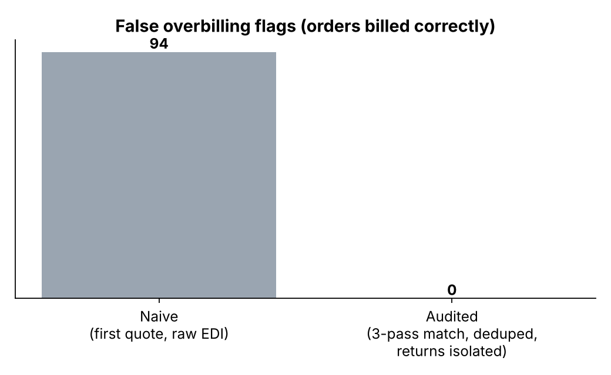
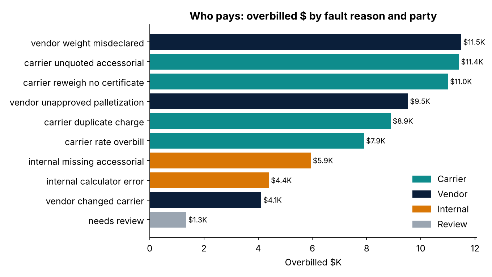

# LTL freight auditor

> Carriers bill differently than they quote. This agent finds every overbilled shipment, works out **who should pay** (carrier, vendor or us), gathers the **email evidence**, and drafts the dispute, all before a human approves anything.

A clean-room rebuild, **on fully synthetic data**, of a freight audit system I built for a large-item furniture marketplace. In production it:

- reconciled API-quoted rates against EDI-billed charges **line by line across 12 LTL carriers**, each with its own quote format
- flagged orders overbilled by more than **$15** in a rolling one-year window (1,000+ flagged orders a year for the first three carriers alone)
- cut per-order reconciliation from **hours to seconds**, with an audit trail for carrier disputes
- ran an agent (Claude Agent SDK, self-hosted inside the company network) that searched two shared ops mailboxes for evidence and assigned fault under **10 written fault reasons across 3 parties**
- left credit memos to a human approval step, reaching production through three small, specific IT asks after being proven on historical claims

No company data, carriers or code are included. Carrier names, vendors, orders and emails here are invented.

## How it works

```mermaid
flowchart LR
    Q[Carrier quotes<br/>3 formats] --> P[Parsers<br/>3-pass quote match]
    E[EDI bills<br/>one row per charge] --> H[Hygiene<br/>dedupe re-sends · isolate returns · sum split invoices]
    P --> R[Reconcile<br/>charge-line variance]
    H --> R
    R -->|> $15 over| A{Agent}
    M[shipping@ / dispositions@] --> A
    A --> F[Fault rules<br/>10 reasons x 3 parties]
    F --> C[Carrier dispute draft]
    F --> V[Vendor chargeback draft]
    F --> I[Internal fix: calculator / booking flags]
    F --> HR[Human review]
```

## The fault rules (who pays)

| Party | Reason | Deciding evidence |
|---|---|---|
| Carrier | Rate overbill | Linehaul above quote, no weight change, quote at lane norm |
| Carrier | Unquoted accessorial | Beyond-area / CA / inside delivery billed, not quoted, no delivery-condition evidence |
| Carrier | Reweigh without certificate | Weight up, **no inspection certificate** in either mailbox |
| Carrier | Duplicate charge | Same charge on two invoice lines |
| Vendor | Unapproved palletization | Palletization billed **and** vendor email says they palletized |
| Vendor | Weight misdeclared | Weight up **and** carrier's inspection certificate on file |
| Vendor | Changed carrier | Billed by a different carrier **and** vendor's change notice on file |
| Internal | Rate calculator error | Our quote far below the carrier's lane norm; bill is at norm |
| Internal | Missing accessorial at booking | Residential delivery, but liftgate/residential never flagged |
| Review | Can't be settled | e.g. carrier changed with no notice found: a person decides |

The same billed amount can belong to different parties depending on the **email**. Whether a reweigh comes with a certificate or not is the difference between a carrier dispute and a vendor chargeback. That's why the agent searches the inboxes, not just the data.

## Data traps it handles

| Trap | Fix | Effect |
|---|---|---|
| One carrier returns several service-level quotes; the booked one isn't always first | 3-pass match: booked total → service level → first valid | Correct quote selected |
| EDI re-transmissions duplicate lines | Dedupe on invoice + line number; a repeat charge on a *new* line is kept as a real duplicate charge | Re-sends dropped, real duplicates disputed |
| Return legs billed on the same PO | Isolated from delivery variance | No false overbills |
| Balance-due second invoices | Summed per charge across invoices | Complete bill |



## A weekly run (synthetic, 1,500 orders)

```
Reconciled 1,500 LTL orders; 555 overbilled by more than $15 ($76,027).
Data hygiene: dropped 71 re-sent EDI lines, isolated 101 return-leg lines.
Carrier disputes drafted: 306 ($39,208 recoverable).
Vendor chargebacks drafted: 161 ($25,133).
Internal fixes (calculator / booking flags): 77 ($10,337 of cost to stop recurring).
Held for human review: 11.
Nothing was sent. All cases await approval in the recoveries queue.
```

Measured against the hidden truth in the synthetic data: **96.7% fault-party accuracy**, **0 false flags** (vs 94 with naive parsing), 11 cases correctly sent to human review.



Sample outputs: a [carrier dispute](output/sample_case_carrier.md), a [vendor chargeback](output/sample_case_vendor.md), an [internal fix](output/sample_case_internal.md), a [human-review case](output/sample_case_review.md), and the weekly [`fault_report.xlsx`](output/).

## Run it

```bash
pip install -r requirements.txt
python run_audit.py                               # offline plan, no keys needed
ANTHROPIC_API_KEY=... python run_audit.py --live  # Claude drives the tool loop
pytest -q                                         # 6 tests: parsers, 3-pass match, hygiene, accuracy, split invoices, nothing sent
```

```
src/freightaudit/
  simulate.py    synthetic quotes (3 formats), EDI lines, ops emails, hidden truth
  parsers.py     one parser per carrier format + 3-pass quote matching
  reconcile.py   hygiene + charge-line reconciliation
  faults.py      the 10 written fault rules, each citing its evidence
  agent.py       tool-use loop (live or offline), case packaging, weekly report
```

## Design choices
- **One source of truth.** In production, the agent called the same reconciliation code as the team's UI tool, so the two never drifted apart.
- **Evidence, not inference.** Each verdict cites the data fields and the email that decided it. If nothing settles fault, the case goes to a person.
- **Stop before money moves.** The agent drafts; humans approve disputes, chargebacks and credit memos.
- **Prototype, prove, then ask.** Validate on historical claims, then make small, specific IT requests (service mailbox, hosting slot, read access).

---
**Amrisha Rajkhowa** · Product & analytics leader · [LinkedIn](https://ca.linkedin.com/in/amrisha-rajkhowa-ubc) · more: [sku-profitability-agent](https://github.com/amr-nerdie1/sku-profitability-agent) · [bayesian-bid-pricing](https://github.com/amr-nerdie1/bayesian-bid-pricing) · [pro-self-serve-platform](https://github.com/amr-nerdie1/pro-self-serve-platform)
